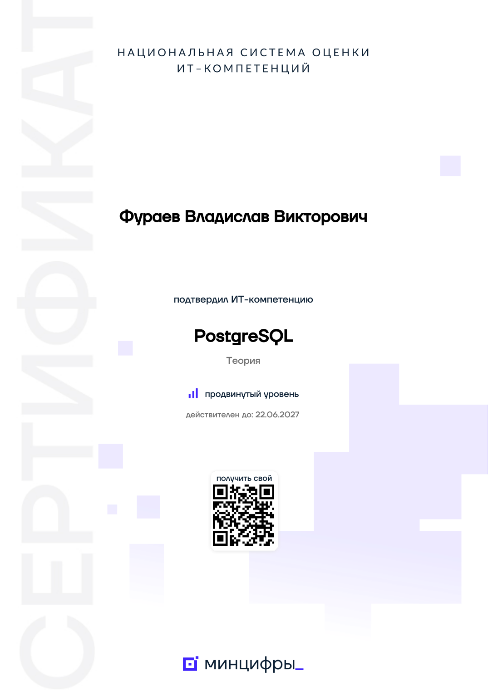

# Привет! Я Владислав 👋

**Python-разработчик · базы данных · машинное обучение**

Студент ТулГУ (ИПМКН). Пишу backend на Django и FastAPI, проектирую базы данных в PostgreSQL и MS SQL Server, готовлю ВКР по системам поддержки принятия решений на машинном обучении.

 

## ⚡ Коротко

- 📜 **Сертификат Минцифры: PostgreSQL, продвинутый уровень** — Национальная система оценки ИТ-компетенций, действителен до 22.06.2027.
- 🎓 **2 проекта — основа ВКР**: СППР на машинном обучении, от обследования и ТЗ по ГОСТ до прототипа модели.
- 📊 **Анализ данных Росстата**: регрессионная модель социально-экономических показателей регионов России, R² до 0.735.
- 🏦 **Курс Python от практика из Сбера** — 8 лабораторных у бывшего руководителя направления ML в Сбербанке: от Git до FastAPI, SQLAlchemy + Alembic и MVC + Repository, с автотестами и CI.
- 💻 **2 курсовые на C++ и Windows API**: настольные приложения без фреймворков — ресторан «зал / кухня» и хранилище документации с триграммным поиском.
- 🚀 **7 проектов Яндекс Практикума**: Django, DRF, JWT, React, Docker, CI/CD через GitHub Actions.
- 🗄️ **3 проекта по базам данных**: PostgreSQL, PL/pgSQL, T-SQL; 8 лабораторных по администрированию с отчётами и единым сценарием запуска.

## 📜 Сертификаты

<table>
<tr>
<td width="240" align="center">

</td>
<td>

**PostgreSQL — продвинутый уровень**

Сертификат **Национальной системы оценки ИТ-компетенций** (Минцифры России): подтверждена ИТ-компетенция «PostgreSQL», раздел «Теория».

- 📅 действителен до **22.06.2027**
- 📄 [оригинал PDF](certificates/it-competence-postgresql.pdf) — файл с Госуслуг без изменений
- 🔎 [контрольная сумма и все сертификаты](certificates/)

Практика по PostgreSQL — в разделе [«Базы данных»](#️-базы-данных): [DATABASE](https://github.com/DarkSwordman999/DATABASE), [TAXI-db](https://github.com/DarkSwordman999/TAXI-db), [VUZ-db](https://github.com/DarkSwordman999/VUZ-db).

</td>
</tr>
</table>

## 🎓 Основа ВКР: системы поддержки принятия решений на машинном обучении

Практические работы по курсу «Программная инженерия» (ТулГУ, ИПМКН): обследование и анализ осуществимости, требования и ТЗ по ГОСТ 34.602-89, функциональная (IDEF0, IDEF3) и объектная (UML) модели, план проекта, первый прототип ML-модели на синтетических данных.

| Проект | Описание | Стек |
|---|---|---|
| [credit-scoring-dss](https://github.com/DarkSwordman999/credit-scoring-dss) | СППР оценки кредитоспособности физических лиц: стоп-факторы, долговая нагрузка, вероятность дефолта (PD), объяснение факторов; прототип сравнивает логистическую регрессию и градиентный бустинг | Python, pandas, scikit-learn, IDEF0, UML |
| [flower-demand-planning](https://github.com/DarkSwordman999/flower-demand-planning) | планирование закупок и продаж цветов: партионный учёт по срокам, прогноз спроса с учётом праздников, заказ поставщику по модели newsvendor, уценка | Python, pandas, scikit-learn, IDEF0, UML |

## 📊 Анализ данных

| Проект | Описание | Стек |
|---|---|---|
| [socioeconomic-factors-analysis](https://github.com/DarkSwordman999/socioeconomic-factors-analysis) | как ВРП, инвестиции и доходы населения влияют на уровень бедности, продолжительность жизни и обеспеченность жильём в регионах России: данные сборника Росстата «Регионы России» (2025), очистка и объединение, описательная статистика, множественная регрессия; лучше всего объясняется уровень бедности (**R² = 0.735**), главный фактор его снижения — рост доходов | Python, pandas, scikit-learn, statsmodels |

## 🏦 Курс Python от практика из Сбера — 8 лабораторных

> **Преподаватель — Алексей Васильевич Цымлов** ([@Tsymlov](https://github.com/Tsymlov))
> - руководил направлением в **Сбербанке** — департамент экспериментальных систем машинного обучения;
> - инженер в коммерческой разработке с 2006 года: мобильные продукты для **Сбера, Kaspersky, Яндекса и Т-Банка**;
> - основатель и генеральный директор ИТ-компании «Синтропик»; преподаёт в ТулГУ ([о преподавателе](https://syntropic.ru/rukovoditel.html)).

Курс построен как в индустрии: каждая работа — отдельный репозиторий с заданиями средней и повышенной сложности, README с разбором решения, автотестами (`unittest` / `pytest`) и проверкой кода `flake8` в **GitHub Actions** (lab2–lab8). Путь — от Git и основ языка до веб-приложения на FastAPI, ORM с миграциями и слоистой архитектуры MVC + Repository.

| № | Репозиторий | Что сделано | Технологии |
|---|---|---|---|
| 1 | [lab1_Git](https://github.com/DarkSwordman999/lab1_Git) | консольный Todo List; ветки `main` / `develop`, слияния, работа с GitHub | Git, GitHub |
| 2 | [lab2_Python](https://github.com/DarkSwordman999/lab2_Python) | структурное программирование: словарь квадратов, Фибоначчи, переворот строки, сериализация в JSON, консольное меню | Python, json, unittest |
| 3 | [lab3_OOP](https://github.com/DarkSwordman999/lab3_OOP) | ООП: класс-итератор `FloatRange`, «Студент», счётчик, система заказов «Товар — Корзина — Заказ»; разработка по TDD | Python, unittest — 37 тестов |
| 4 | [lab4_Functional](https://github.com/DarkSwordman999/lab4_Functional) | функциональный стиль: `map` / `filter`, декоратор замера времени, собственный `reduce`, каррирование | Python, functools, unittest |
| 5 | [lab5_GUI](https://github.com/DarkSwordman999/lab5_GUI) | графические интерфейсы: окна на Tkinter и PyQt5, диалог выбора файла, локальный чат, игра «Кликер» с сохранением прогресса | Tkinter, PyQt5, unittest |
| 6 | [lab6_Web](https://github.com/DarkSwordman999/lab6_Web) | веб-приложение: REST API задач, страницы на Jinja2, регистрация и вход (хеширование паролей, подписанные токены), Swagger | FastAPI, Pydantic, Jinja2, pytest — 37 тестов |
| 7 | [lab7_Databases](https://github.com/DarkSwordman999/lab7_Databases) | учёт студентов, курсов и оценок: sqlite3, JOIN-отчёты, ORM-модель, 4 миграции схемы | sqlite3, SQLAlchemy, Alembic, pytest — 32 теста |
| 8 | [lab8_Ecosystem](https://github.com/DarkSwordman999/lab8_Ecosystem) | Booktracker — учёт прочитанных книг с подгрузкой по ISBN из Open Library; архитектура MVC, слой сервисов, шаблон Repository | Poetry, requests, argparse, pytest — 44 теста |

## 💻 Курсовые по программированию: C++ и Windows API

Настольные приложения на C++17 с интерфейсом на чистом Windows API — без фреймворков и сторонних библиотек; объектно-ориентированная архитектура, UML-диаграммы, пояснительные записки по ГОСТ. Разработаны и собраны в Code::Blocks (MinGW-w64 GCC).

| Проект | Описание | Стек |
|---|---|---|
| [restaurant-order-system](https://github.com/DarkSwordman999/restaurant-order-system) | ресторан: обработка заказов «зал / кухня» — столы и меню, заказ от создания до подачи, очередь кухни, статусы блюд, выручка за день | C++17, Windows API, Code::Blocks |
| [construction-doc-storage](https://github.com/DarkSwordman999/construction-doc-storage) | строительство: хранилище проектной документации — реестр документов, триграммный поиск по фрагменту и с опечатками (сходство Жаккара), сохранение и загрузка | C++17, Windows API (Unicode), Code::Blocks |

## 🚀 Проекты Яндекс Практикума

| Проект | Описание | Стек |
|---|---|---|
| [kittygram-final-ad](https://github.com/DarkSwordman999/kittygram-final-ad) | fullstack-приложение в Docker, CI/CD через GitHub Actions | Django, React, Docker, GitHub Actions |
| [api-final-yatube-ad](https://github.com/DarkSwordman999/api-final-yatube-ad) | API соцсети: посты, комментарии, группы, подписки, JWT | Django REST Framework, SimpleJWT |
| [api_yatube](https://github.com/DarkSwordman999/api_yatube) | REST API для соцсети Yatube | Django REST Framework |
| [django_sprint4](https://github.com/DarkSwordman999/django_sprint4) | Blogicum: регистрация, аутентификация, восстановление пароля | Django |
| [django_sprint3](https://github.com/DarkSwordman999/django_sprint3) | Blogicum: модели, представления, шаблоны | Django |
| [django_sprint1](https://github.com/DarkSwordman999/django_sprint1) | Blogicum: вёрстка ленты и страниц | HTML, Bootstrap 5 |
| [the_snake](https://github.com/DarkSwordman999/the_snake) | игра «Змейка» | Pygame, pytest |

## 🗄️ Базы данных

| Проект | Описание | Стек |
|---|---|---|
| [DATABASE](https://github.com/DarkSwordman999/DATABASE) | ПАБД: база SALES — 8 лабораторных работ (сервер в сети, объёмная БД и индексы, пользовательские типы, резервное копирование, функции на C, перенос в MS SQL Server, представления и функции T-SQL, программы на C# и Python), защиты ЛР2 и ЛР3, отчёты, единый сценарий запуска | PostgreSQL, PL/pgSQL, T-SQL, C, C#, Python, PowerShell |
| [VUZ-db](https://github.com/DarkSwordman999/VUZ-db) | база данных успеваемости вуза | PostgreSQL, PL/pgSQL |
| [TAXI-db](https://github.com/DarkSwordman999/TAXI-db) | база данных службы такси: аналитические запросы, представления, функции, отчёты и GUI | PostgreSQL, PL/pgSQL, Python |
